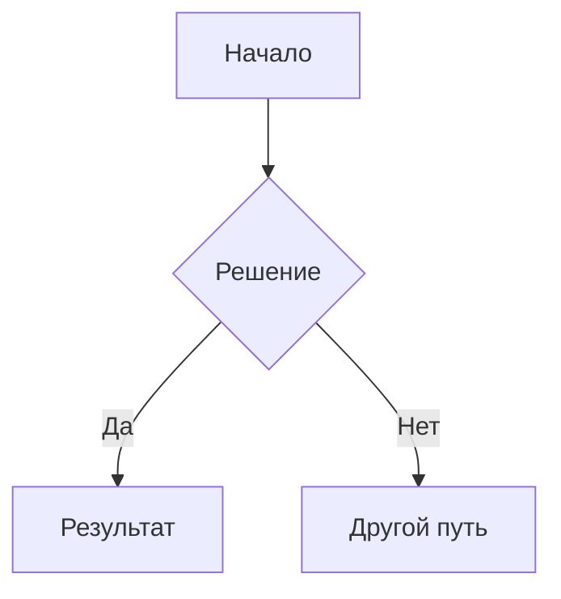
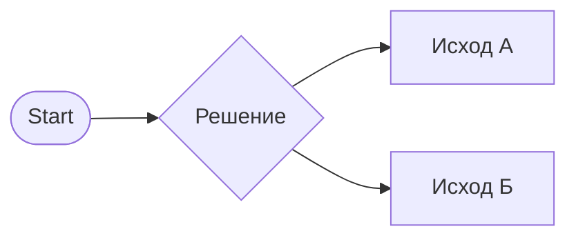

---
# Темы занятия
• Классы
• Объекты
• Поля и методы класса
• Создание объекта класса
• Конструктор по умолчанию
• Обращения к функциональности класса

---
# Домашние задания
## Постановка
1. Выполните **индивидуально** **Задание** 1.
2. Выполните **индивидуапльно** **Задание** 2.
3. Выберите **совместно** с рабочей группой часть задач для выполнения **Задания** 3.
4. Сформулируйте **список вопросов**, возникших в ходе выполнения **заданий** 1, 2 и 3.
5. **Передайте** список вопросов **Лидеру** группы.
6. (**==Выполняет Лидер группы==**) **Оформите Отчёт** о проделанной работе. Прикрепите список вопросов от каждого участника рабочей группы к Отчёту. (Рекомендации по оформлению отчёта см. ниже.)
7. (**==Выполняет Лидер группы==**) **Отправьте Отчёт** о проделанной работе на указанную ниже электронную почту.

## Задание 1

**Доработайте** класс `Book`:
1. добавьте в **главный конструктор** `(title, author, year)`;
2. сделайте **упрощённый конструктор** с `(title)` через `: this(title, "неизвестен", 0)`;
3. **создайте** одну **книгу** через **инициализатор** объекта;
4. **добавьте** `Deconstruct(out string title, out bool isRead)` и **распакуйте книгу**.

## Задание 2

**Задание для разминки**:  (см. `//TODO: ⚠️` в коде ниже)
**Дополните** логику класса Хранилища Книг(и) **методом размещения Книги в хранилище** (размещение неопределённой книги считаем невозможным) - возможность разместить Книгу в хранилище должна быть **только у владельца Хранилища** (если он определён) - всё как для логики **метода Извлечения Книги** из Хранилища (продемонстрируйте работу методов размещения и извлечения Книги из Хранилища):
```cs
// Хранилище книг студента
class StudentBookStorage
{
    // Владелец хранилища
    private Student? StorageOwner;
    // Книга в хранилище
    private Book? StoredBook;

    // Главный конструктор - вся инициализация в нём
    public StudentBookStorage(Student owner, Book book)
    {
        StorageOwner = owner;
        StoredBook = book;
    }

    // Упрощённые конструкторы делегируют главному, подставляют значения по умолчанию
    public StudentBookStorage(Student owner) : this(owner, null){}
    public StudentBookStorage() : this(null){}

    // Извлечение Книги из Хранилища
    public Book GetABook(Student student)
    {
        // Проверяем доступ и решаем - давать книгу или нет
        if(IsValidAccess(student))
        {
            return this.StoredBook;
        }
        return null;
    }

    //TODO: ⚠️ Напишите метод для размещения книги в хранилище - PutABook ⚠️

    private bool IsValidAccess(Student student)
    {
        // Нет студента - нет доступа!
        return student != null && 
        // Нет владельца - значит ничейное.
            (StorageOwner == null || 
            // Есть владелец и он перед нами - даём доступ.
            string.Equals(student.GetName(), StorageOwner.GetName()));
    }

}
```

## Задание 3 (групповое)

Ознакомьтесь с описаниями классов ниже:
### Примеры классов почти из жизни
---
**Пример 1:** Класс **Пользователей**.

Нам не важен **цвет глаз** и **любимый аромат** или **рисунок отпечатков пальцев** пользователя, если мы **банк** или **система управления запасами предприятия**. (Перечисленные свойства могут быть важны в системах, **обслуживающих модельные агентства, отели** или **полицейское управление** соотвественно.)

Обычно от пользователей нам нужны:
- **ФИО**
- **логин**
- **пароль** (обычно - хэш пароля, если мы говорим о хранимых данных)

Кроме того, пользователю в информационных системах обычно присваивается уникальный **идентификатор**, сокращённо - ID.

По этому идентификатору пользователя можно быстро найти в соответствующей таблице базы данных (БД) приложения.

Итого, у Пользователя будет следующий набор свойств:
- **ID**
- **ФИО**
- **логин**
- **пароль**

---

**Пример 2**: Класс **Контакта**.

Обычно, контакты (пользователя) определяются **типом канала связи** и **идентификатором пользователя в этом канале связи** (не путать с рассмотренным выше уникальным ВНУТРЕННИМ идентификатором пользователя - **ID**).

Например:
- **почта**: `usermail@mail.ru`
- **телефон**: `+79991234567`
- **мессенджер**: `username`

Причём для мессенджеров и телефонов **могут быть предусмотрены дополнительные свойства**, позволяющие понять - что это за телефон (домашний, мобильный, рабочий и.т.д) и в каком мессенджере искать пользователя с указанным именем (обычно - идентификатор мессенджера из соответствующей таблицы БД).

Точно так же, как и у Пользователя - у Контакта может и должен быть свой идентификатор.

**Бывает** так, что **контакты делают неотъемлемым свойством Пользователя**. В некоторых случаях это вполне допустимо. Особенно, если это простая **записная книжка**.

В данном случае мы рассматриваем **класс Контакта**, как **отдельную сущность**.
Пользователю может принадлежать **множество контактов**, что может быть представлено как **коллекция Контактов** в сущности (объекте) Пользователя или в сущности, связывающей объект Пользователя с объектами Контактов (рассмотрим такой пример ниже).

Пока что **Контакт** - это некий канал связи и идентификатор, о которых **знает наша система**, подвешенные в воздухе.

Итого, какие у Контакта будут поля:
- **ID**
- **ID Канала Связи**
- **Идентификатор в канале связи (Имя)**

---

**Пример 3: Канал Связи**
Представим, что для типа канала существует свой класс **Канал Связи**, в котором для простоты указаны всего два поля: 
- **ID** 
- **Имя  Канала**.

---

**Пример 4**: **Профиль Пользователя**
Хватит Пользователю и Контактам висеть в воздухе.

Раз нам нужна точка, где мы будем понимать, какие контакты есть у конкретного пользователя, то нужно такую точку создать.

**Профиль пользователя** будет агрегирующим классом, в котором мы будем собирать всю нужную нам статистику пользователя.

Этот класс мы будем более активно менять или расширять с помощью классов-наследников в будущем с целью поддержания единой точки доступа ко всем необходимым для бизнеса **свойств Пользователя**.

Какие поля мы увидим в классе **Профиля Пользователя**:
- **Пользователь**
- один **Контакт** (Если хотите чуть сложнее - коллекция или массив Контактов)
- **прочие** свойства, которые мы можем добавить позже...

---

### Рекомендации по выполнению группового задания

Каждая рабочая группа распределяет между напарниками по одному классу (по два - если самых простых) из примеров выше: **Пользователя**, **Канал Связи**, **Контакт** и **Профиль Пользователя**. **Задача**. 

**Что нужно выполнить:**
	1. Написать **код** для каждого из этих **классов**
	2. (**Задача Лидера** рабочей группы) Написать простую компоновку для этих классов (**создать Профиль Пользователя**, **наполнить** его **данными**) для **демонстрации** возможности работы этих классов друг с другом.
	3. **Написать** простой **"сервисный" класс**, с помощью которого можно **создавать профили**, вносить в них **изменения**, получать **краткую статистику профиля** (с использованием деконструкторов). (Или реализовать подобный функционал на уровне точки входа в приложение.)
3. Записать проблемы, с которыми пришлось столкнуться во время работы над задачами. **Сформулировать вопросы.**

**Уточнения к домашнему заданию:**
1. **Старший в группе (Лидер)** отвечает за качество компоновки и сервиса работы с Профилями Пользователя. Хорошая компоновка **+1 к личной оценке**. Плохая компоновка **-1 к оценке каждого в группе**. (Плохая демонстрация хорошего продукта в жизни губит продукт и команду, потратившую на его разработку силы и время.)
2. Исполнители **отвечают каждый за свою часть**.
3. **Проверяйте код друг друга**, советуйтесь, обсуждайте трудные места, задавайте вопросы.
4. **Результаты** на указанную ниже почту **присылает лидер** рабочей **группы** или тот, кто его временно замещает.
5. В **результатах** домашней работы указать **участников рабочей группы** (3-4 человека, **включая лидера**), архив с **проектом**, краткую **документацию** (состав проекта, назначение классов, варианты запуска, если их больше одного, описание ожидаемого результата)

**==Срок сдачи до вечера пятницы.==** (23.10.2026)

---
# Куда присылать выполненные задания

Электронная почта: moysklad-students-homework@mail.ru

В теме письма нужно указать:
**"ООП 2026 Домашнее задание " + номер задания + ФИО**

номер задания - для текущего занятия - 1.
ФИО - Фамилия Имя О.

---
# Рекомендации по оформлению Отчёта о проделанной работе (для Лидера группы)

**Что в отчёте по заданию:**
- **Код** – файлы классов или архив с проектом
- Пояснительный **материал**: `readme.md` (**Для создания рекомендуется Obsidian - материалы по использованию будут приложены к письму с домашним заданием**)
- **Вопросы** (Собрать у всех участников рабочей группы).

**Что должно быть в `readme.md`:**
- Список **участников** рабочей группы (ФИО полностью)
- Имя **лидера** рабочей группы.
- **Номер учебной группы**
- **Описание** выполненной работы с указанием **номера занятия** и **текста задания**.
- **Результаты выполнения** работы.
- (опционально) Вопросы.

---
# Материалы
# Классы и объекты
**Классы** - это **модели**, описывающие множество **объектов**, обладающих одинаковыми **наборами свойств и методов**.

Класс **не обязан обладать ВСЕМИ свойствами реальных объектов**, описываемых им.
Мы **добавляем в класс** только то, что **нужно нам для решения конкретной задачи**.

**Объекты** - это **экземпляры класса**, т.е. сущности, обладающие **свойствами и методами**, обозначенными в **классе**.

У **объекта** каждое **поле** (**свойство**) имеет некоторое **значение** (в том числе, обозначающее отсутствие конкретного значения).
Каждый **метод** объекта так или иначе имеет **реализацию** (даже пустую).

**Объект** - это **конкретный представитель** своего **класса**.

**Поля (свойства)** класса - это **набор характеристик**, свойственных всем объектам класса.

**Методы** класса - это **действия**, которые могут выполнять все объекты класса.

Класс Книги с открытыми полями (книга не будет возражать, если вы захотите узнать её название или количество страниц в ней)

```cs
class Book
{
    public string Name = "Unnamed";
    public int PagesCount;

    // Деконструктор (не путать с деструктором!) для быстрого получения значений полей.
    
    // (Имя, Количество страниц)
    public void Deconstruct(out string name, out int pages)
    {
        name = Name;
        pages = PagesCount;
    }
}
```

Класс студента (а вот студент может быть против разглашения своего имени и возраста):
```cs
class Student
{

    private const string UNKNOWN = "Unknown" ;

    // Поля (состояние экземпляра)
    private string? Name;
    private int Age;

    // Конструктор без параметров
    public Student()
    {
        Name = UNKNOWN;
        Age = 0;
    }

    // Конструктор с параметрами
    public Student(string name, int age)
    {
        Name = name;
        Age = age;
    }

    // Методы (доступные действия экземпляра)
    public string? GetName(){
        return string.IsNullOrEmpty(Name) ? UNKNOWN : Name;
    }

    public int GetAge(){
        return Age;
    }

    public void SetName(string Name){
        this.Name = Name;
    }

    public void SetAge(int Age){
        this.Age = Age;
    }
}
```

Для класса можно не прописывать **конструктор**, тогда для него будет определён **конструктор по умолчанию** (без параметров), который инициализирует все поля значениями по умолчанию в зависимости от их типа.
# Создание экземпляра класса - объект

```cs
// Главный класс приложения
class Program
{
    // Главный метод класса приложения (входная точка)
    static void Main()
    {
        ShowBooks();
        IntroduceStudents();
    }

    // Остальные методы класса приложения

    // Простые классы с открытыми свойствами
    private static void ShowBooks()
    {
        // Создаём экземпляры конструктором по умолчанию
        Book TheBook = new Book();
        Book AnotherBook = new();

        // Меняем свойства экземпляра напрямую
        TheBook.Name = "The Book";
        TheBook.PagesCount = 100;

        Show(TheBook);
        Show(AnotherBook);

        // Используем инициализатор с избирательным присвоением значения параметрам
        Show(new Book()
        {
            Name = "Инициализаторы объектов: присваиваем значения открытым полям",
            PagesCount = 42
        });

        (string BookName, int BookPagesCount) = TheBook;
        Console.WriteLine(
            $"Из всех книг вам приглянулась {BookName}, в которой было ровно {BookPagesCount} страниц."
        );
    }

    // Простые классы с закрытыми свойствами
    private static void IntroduceStudents()
    {
        // Создание экземпляров конструктором БЕЗ параметров
        Student StudentOne = new();
        // Вызов методов-сеттеров
        StudentOne.SetName("Анна");
        StudentOne.SetAge(20);

        // Создание экземпляров конструктором С параметрами
        Student StudentTwo = new("Иван", 22);

        Introduce(StudentOne);
        Introduce(StudentTwo);
    }

    // Чтение состояния напрямую из свойств объекта
    private static void Show(Book book)
    {
        Console.WriteLine(
            $"Вы видите книгу {book.Name}, в ней {book.PagesCount} страниц."
        );
    }

    // Чтение состояния через вызов методов-геттеров
    private static void Introduce(Student Student)
    {
        Console.WriteLine(
            $"Привет! Меня зовут {Student.GetName()}, мне {Student.GetAge()} лет."
        );
    }

}
```

**Что запомнить:**
- `Name` и `Age` — это **поля** класса (состояние каждого объекта своё).
- `new Student()` — создание экземпляра.
- `StudentOne.SetAge(20)` — вызов метода у конкретного объекта.
- **Мотивация:** без класса нам понадобилось бы 4 переменные (`name1, age1, name2, age2`)  — и при добавлении 3-го студента всё размножается. Класс «сшивает» данные и поведение в одно целое.

Что под капотом у созданного конструктором по умолчанию студента:
```cs
Student defaultStudent = new Student();
Introduce(defaultStudent);
```

---

## Инструменты
### Obsidian
Где взять: 
Сайт: https://obsidian.md/download
Скачать, воспользоваться инструкциями к установщику.

#### Установка и запуск на Windows
1. Скачиваем exe файл.
2. Запускаем установщик.
3. Выбираем место установки на диске.
4. Дожидаемся окончания установки.
5. Находим ярлык приложения Obsidian в меню Пуск или на Рабочем Столе.
6. Запускаем.
7. Создаём новую базу знаний (Vault, Хранилище) - Выбираем место на диске - папку, задаём имя новой базе знаний ("САиПР-ФамилияИО"), подтверждаем.
#### Установка на Linux
1. по любой из инструкций скачиваем и устанавливаем пакет obsidian.
2. дожидаемся окончания установки.
3. в графической оболочке в аналоге меню Пуск находим Obsidian.
4.  Запускаем.
5. Создаём новую базу знаний (Vault, Хранилище) - Выбираем место на диске - папку, задаём имя новой базе знаний ("САиПР-ФамилияИО"), подтверждаем.

#### Установка на Android/iOS
1. Идём в магазин приложений
2. Находим Obsidian
3. Устанавливаем
4. Дожидаемся установки.
5. Находим ярлык приложения на главном экране устройства.
6. Запускаем.
7. Создаём новую базу знаний (Vault, Хранилище) - Выбираем место на диске - папку, задаём имя новой базе знаний ("САиПР-ФамилияИО"), подтверждаем.

#### Возможности (далеко не все!)

---
## Создание статей

### 1. Разметка статей

#### 1.1 Заголовки

**Порядок действий:**
Боковая панель -> Вкладка «Папки» -> Клик ПКМ -> В появившемся меню выбрать -> «Новая заметка» -> Ввести заголовок через символы `#`

**Синтаксис:**
- `# Заголовок 1` — самый крупный уровень
- `## Заголовок 2` — второй уровень
- `### Заголовок 3` — третий уровень
- До шести уровней (`######`)

#### 1.2 Ссылки

**Порядок действий:**
Боковая панель -> Вкладка «Папки» -> Открыть заметку -> Ввести `[[` -> Начать вводить имя заметки -> Выбрать из выпадающего списка

**Синтаксис:**
- `[[Имя заметки]]` — внутренняя ссылка на другую заметку
- `[[Имя заметки|Отображаемый текст]]` — ссылка с альтернативным текстом
- `[Текст](https://example.com)` — внешняя ссылка

#### 1.3 Иллюстрации

**Порядок действий:**
Боковая панель -> Вкладка «Папки» -> Клик ПКМ на папке -> В появившемся меню выбрать -> «Показать в системном проводнике» -> Скопировать изображение в папку хранилища -> Вернуться в Obsidian -> Вставить `![[имя_файла.png]]`

**Синтаксис:**
- `![[изображение.png]]` — вставка изображения из хранилища
- `` — вставка с подписью (стандартный Markdown)

#### 1.4 Таблицы

**Порядок действий:**
Боковая панель -> Вкладка «Папки» -> Открыть заметку -> Ввести таблицу вручную или через команду `Insert table` в палитре команд (`Ctrl+P`)

**Синтаксис:**
```markdown
| Заголовок 1 | Заголовок 2 |
|-------------|-------------|
| Ячейка 1    | Ячейка 2    |
| Ячейка 3    | Ячейка 4    |
```

#### 1.5 Форматирование текста

**Порядок действий:**
Боковая панель -> Вкладка «Папки» -> Открыть заметку -> Выделить текст -> Использовать горячие клавиши или ввести символы вручную

**Синтаксис:**
- `**жирный**` — жирный текст
- `*курсив*` — курсив
- `==выделенный==` — выделение маркером
- `~~зачёркнутый~~` — зачёркнутый текст
- `` `код` `` — встроенный код
- `> цитата` — блок цитаты
- `- пункт списка` — маркированный список
- `1. пункт` — нумерованный список

---

## Создание холстов (Canvas)

### 1. Создание узлов

**Порядок действий:**
Боковая панель -> Вкладка «Папки» -> Клик ПКМ -> В появившемся меню выбрать -> «New canvas» -> Двойной клик на холсте -> Появится текстовый узел -> Ввести содержимое

**Альтернативные способы:**
- **Из заметки**: Боковая панель -> Вкладка «Папки» -> Перетащить файл заметки на холст
- **Из медиа**: Боковая панель -> Вкладка «Папки» -> Перетащить изображение/PDF на холст
- **С веб-страницы**: Клик ПКМ на холсте -> «Add web page» -> Ввести URL 

### 2. Создание связей

**Порядок действий:**
Боковая панель -> Вкладка «Папки» -> Открыть холст -> Навести курсор на грань узла (появится точка) -> Зажать и потянуть к другому узлу -> Отпустить

**Настройка связи:**
Клик ПКМ на связи -> «Edit label» -> Ввести подпись -> Enter 

### 3. Управление стилями узлов и связей

**Порядок действий (базовые стили):**
Боковая панель -> Вкладка «Папки» -> Открыть холст -> Клик ПКМ на узле или связи -> «Color» -> Выбрать цвет (6 предустановленных: красный, оранжевый, жёлтый, зелёный, голубой, фиолетовый) 

**Порядок действий (расширенные стили через плагин Advanced Canvas):**
Боковая панель -> Вкладка «Папки» -> Настройки (⚙️) -> «Community plugins» -> «Browse» -> Найти «Advanced Canvas» -> Установить -> Включить -> Клик ПКМ на узле -> Появятся дополнительные опции (формы, стили границ, стили стрелок) 

### 4. Размещение ссылок на холсты в статьях

**Порядок действий:**
Боковая панель -> Вкладка «Папки» -> Открыть заметку -> Ввести `![[имя_холста.canvas]]`

**Важное примечание:**
Встроенный предпросмотр холста в заметке показывает только миниатюру, без содержимого. Для полноценного встраивания требуется сторонний плагин (например, `inline-canvas`), либо экспорт холста как изображения .

---

## Встраиваемые в статьи диаграммы

### 1. Mermaid диаграммы
https://mermaid.js.org/

**Порядок действий:**
Боковая панель -> Вкладка «Папки» -> Открыть заметку -> Ввести три обратные кавычки + `mermaid` -> Написать код диаграммы -> Закрыть тремя обратными кавычками

**Пример кода:**
````markdown

````

#### 1.1 Язык разметки Mermaid диаграмм

**Основные типы диаграмм:**

| Тип диаграммы | Ключевое слово | Применение |
|---------------|----------------|------------|
| Блок-схема | `flowchart` | Процессы, алгоритмы |
| Диаграмма последовательности | `sequenceDiagram` | Взаимодействия |
| Диаграмма классов | `classDiagram` | ООП, структуры |
| Диаграмма состояний | `stateDiagram-v2` | Жизненные циклы |
| Диаграмма Ганта | `gantt` | Планирование |
| Интеллект-карта | `mindmap` | Иерархии |
| Круговая диаграмма | `pie` | Пропорции |
| ER-диаграмма | `erDiagram` | Базы данных |
| Git-граф | `gitGraph` | Ветвление |
| Диаграмма временной шкалы | `timeline` | События |

#### 1.2 Типы узлов (для блок-схем)

| Синтаксис | Форма | Пример |
|-----------|-------|--------|
| `A[текст]` | Прямоугольник | `A[Начало]` |
| `B(текст)` | Скруглённый прямоугольник | `B(Процесс)` |
| `C{текст}` | Ромб (решение) | `C{Условие?}` |
| `D[(текст)]` | Цилиндр | `D[(База)]` |
| `E((текст))` | Круг | `E((Старт))` |
| `F{{текст}}` | Шестиугольник | `F{{Этап}}` |

#### 1.3 Типы связей

| Синтаксис | Тип связи |
|-----------|-----------|
| `-->` | Сплошная стрелка |
| `---` | Сплошная линия без стрелки |
| `-.->` | Пунктирная стрелка |
| `==>` | Жирная стрелка |
| `-->|текст|` | Стрелка с подписью |
| `-- текст -->` | Стрелка с подписью (альтернативный синтаксис) |

**Направления диаграммы:**
- `TD` — сверху вниз (Top-Down)
- `LR` — слева направо (Left-Right)
- `BT` — снизу вверх
- `RL` — справа налево


```markdown 
 ```mermaid
flowchart LR
	A(["Start"])
	A --> B{"Решение"}
	B --> C["Исход А"]
	B --> D["Исход Б"]
 ```
```



---
